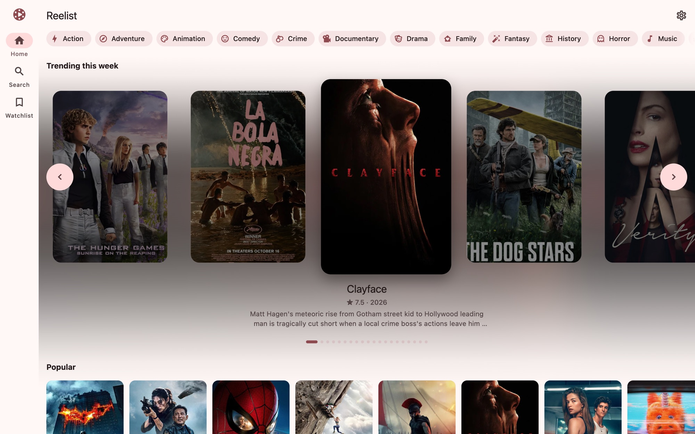
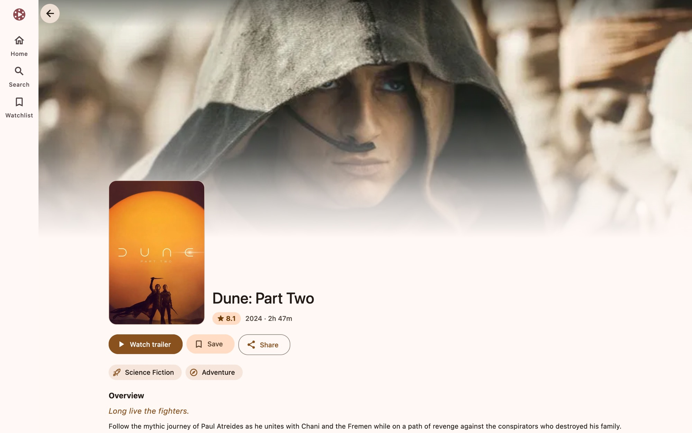
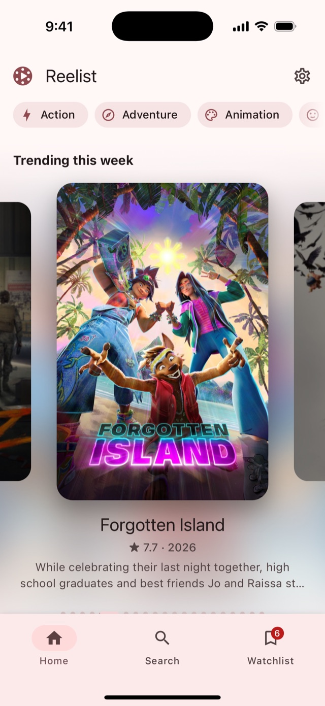
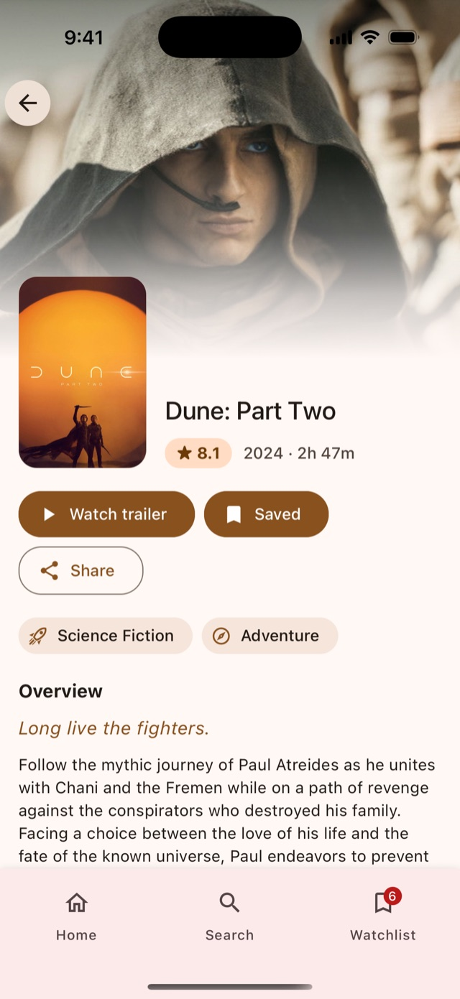
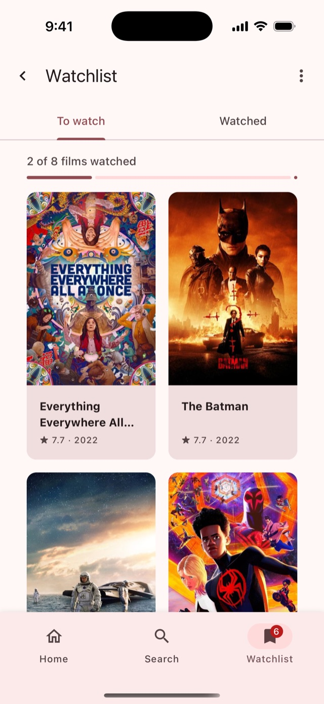
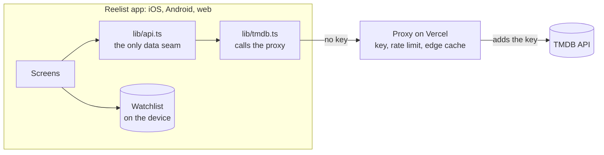

<p align="center">
  <a href="https://reelist.raajnadar.in/">
    
  </a>
</p>

<h1 align="center">Reelist</h1>

<p align="center">
  Browse films, watch trailers, and keep a watchlist.<br />
  One codebase for iOS, Android, and the web.
</p>

<p align="center">
  <a href="https://github.com/raajnadar/reelist/actions/workflows/ci.yml"></a>
  <a href="https://github.com/raajnadar/reelist/actions/workflows/deploy.yml"></a>
  
  
  
  <a href="LICENSE"></a>
</p>

<p align="center">
  <a href="https://reelist.raajnadar.in/"><b>Open the web app</b></a>
  ·
  <a href="#-try-it">Try it on a phone</a>
  ·
  <a href="#-quick-start">Quick start</a>
  ·
  <a href="#-documentation">Documentation</a>
</p>

<p align="center">
  <picture>
    <source media="(prefers-color-scheme: dark)" srcset="assets/docs/screenshots/web-home-dark.jpg" />
    
  </picture>
</p>

## ✨ Features

| Feature                 | What it does                                                                                              |
| ----------------------- | --------------------------------------------------------------------------------------------------------- |
| **Film lists**          | Trending this week, Popular, Top rated, and Popular in the language of your device.                       |
| **Film colours**        | Each film page takes its theme from the main colour of its poster, in light and in dark.                  |
| **Trailers and stills** | The trailer plays inside the app. The gallery shows the stills of the film.                               |
| **Cast and people**     | A cast card opens the person, with each film they appear in, newest first.                                |
| **Genres**              | An endless grid for each genre, with filters for the decade, the rating, the language, and the runtime.   |
| **Search**              | The results change as you type. On the web, `/` opens the search from any page.                           |
| **Watchlist**           | It stays on the device, so it opens offline. It has "To watch" and "Watched" tabs, select mode, and undo. |
| **Adaptive navigation** | A bar on a phone, a rail on a tablet or a laptop, and a drawer on a wide screen.                          |
| **Light and dark**      | System, Light, or Dark. Material Design 3 makes all the colours from one seed colour.                     |
| **No key in the app**   | The TMDB key stays on a server proxy. The app never holds it.                                             |

<p align="center">
  <picture>
    <source media="(prefers-color-scheme: dark)" srcset="assets/docs/screenshots/web-film-dark.jpg" />
    
  </picture>
  <br />
  <sub>Each film page takes its colours from the poster.</sub>
</p>

## 📱 Try it

<p align="center">
  <picture>
    <source media="(prefers-color-scheme: dark)" srcset="assets/docs/screenshots/phone-home-dark.jpg" />
    
  </picture>
  &nbsp;
  <picture>
    <source media="(prefers-color-scheme: dark)" srcset="assets/docs/screenshots/phone-film-dark.jpg" />
    
  </picture>
  &nbsp;
  <picture>
    <source media="(prefers-color-scheme: dark)" srcset="assets/docs/screenshots/phone-watchlist-dark.jpg" />
    
  </picture>
</p>

<table>
  <tr>
    <th width="50%">On a phone</th>
    <th width="50%">In a browser</th>
  </tr>
  <tr>
    <td align="center">
      
      <br />
      Scan with <b>Expo Go</b> on Android,<br />or with the <b>Camera</b> app on iOS.
    </td>
    <td align="center">
      <a href="https://reelist.raajnadar.in/"><b>reelist.raajnadar.in</b></a>
      <br /><br />
      It updates on every push to <code>main</code>.<br />
      You do not need an install or an account.
    </td>
  </tr>
</table>

The QR code always serves the newest commit on `main`. You do not need this
repository or a development server. The app runs on Expo Go SDK 58. Update Expo
Go if it reports a version mismatch.

<details>
<summary>The code does not scan?</summary>

<br />

Open this link on the phone:

```
exp://u.expo.dev/7fe1b9fe-fa75-406c-aaf9-ae330957fc46?channel-name=main
```

</details>

> [!NOTE]
> The browser build has no gestures and no native animation driver, so the
> carousel feels different there. Use the phone build to judge the motion.

## 🚀 Quick start

You need Node.js 24 or later, Yarn 1, the
[Vercel CLI](https://vercel.com/docs/cli), and a
[TMDB API key](https://www.themoviedb.org/settings/api) (v3 auth, 32
characters).

```bash
git clone https://github.com/raajnadar/reelist.git
cd reelist
yarn install
yarn --cwd proxy install
```

**Terminal 1: the proxy.** It holds the TMDB key.

```bash
cd proxy
vercel link                                     # once, to connect the project
echo "TMDB_API_KEY=<your v3 key>" > .env.local
vercel dev                                      # serves http://localhost:3000/api/tmdb
```

**Terminal 2: the app.**

```bash
cp .env.example .env
# Set EXPO_PUBLIC_TMDB_PROXY_URL=http://localhost:3000/api/tmdb in .env
yarn start                                      # then press i, a, or w
```

> [!IMPORTANT]
> Put the TMDB key only in `proxy/.env.local`. A key in the app's `.env` ships
> to every user. [Read why](docs/architecture.md#the-key-never-reaches-the-app).

> [!TIP]
> Metro caches `.env` when it starts. Run `yarn start --clear` after you change
> it. On a phone, use the network address of your computer, not `localhost`.

The full setup, the scripts, and the tests are in
[docs/development.md](docs/development.md).

## 🧭 How it works



- **One seam.** Every screen gets its data from `lib/api.ts` and from nowhere
  else. Two changes of the data source did not touch a screen.
- **One loader.** Each screen loads through `useResource`, which keeps each
  answer for five minutes. A return to a screen draws it on the first frame.
- **One device store.** The watchlist is the only state on the device. It keeps
  each film whole, so it opens offline.

Read the full design notes in [docs/architecture.md](docs/architecture.md) and
[docs/design-system.md](docs/design-system.md).

## 🧰 Tech stack

| Layer    | Technology                                                                                                             |
| -------- | ---------------------------------------------------------------------------------------------------------------------- |
| App      | Expo SDK 58, Expo Router, React Native 0.88, React 19, TypeScript                                                      |
| UI       | [RootNative UI](https://rootnative.github.io/ui/): `@rootnative/core`, `@rootnative/components`, `@rootnative/inertia` |
| Images   | `expo-image`, with a memory cache and a load fade                                                                      |
| Proxy    | Vercel Functions, with an Upstash Redis rate limit                                                                     |
| Web      | A static export, prerendered film pages, and `@rootnative/seo` checks                                                  |
| Tests    | Jest and `@testing-library/react-native`                                                                               |
| Delivery | GitHub Actions, GitHub Pages, EAS Update, and EAS Build                                                                |

## 📚 Documentation

| Page                                              | Read it to                                                                           |
| ------------------------------------------------- | ------------------------------------------------------------------------------------ |
| [Development](docs/development.md)                | Set up the app, run the scripts and the tests, and find your way in the code         |
| [Architecture](docs/architecture.md)              | Learn how the data flows, why the key stays on a server, and how the watchlist works |
| [Built with RootNative UI](docs/design-system.md) | Learn about the themes, the film colours, the motion, and the navigation             |
| [Deployment](docs/deployment.md)                  | Publish the web build, an app update, or a store build                               |
| [The TMDB proxy](proxy/README.md)                 | Run, test, and deploy the proxy                                                      |

## 🙏 Credits

- Film data and images come from [TMDB](https://www.themoviedb.org/). This
  product uses the TMDB API but is not endorsed or certified by TMDB.
- Trailers play from YouTube.
- [RootNative UI](https://rootnative.github.io/ui/) draws every screen.

## 📄 License

[MIT](LICENSE) © 2026 Rajendran Nadar
